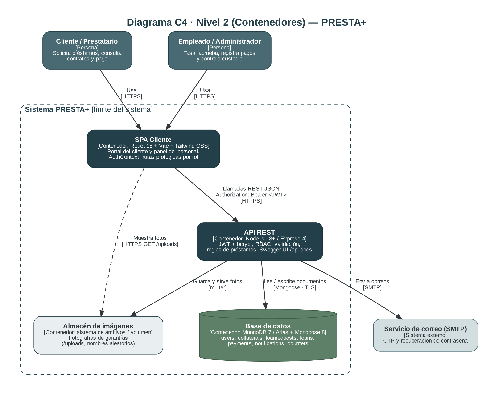
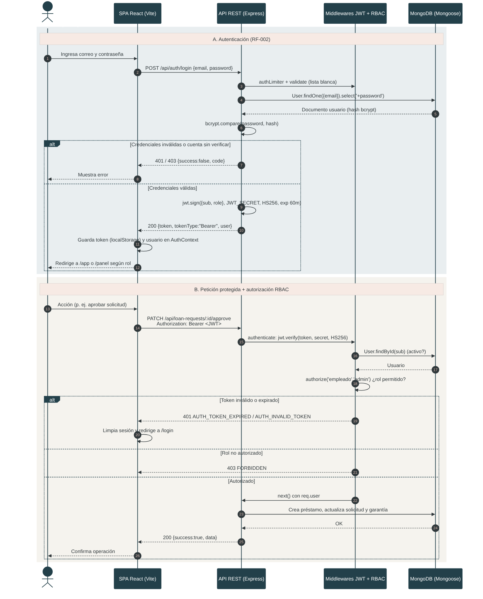
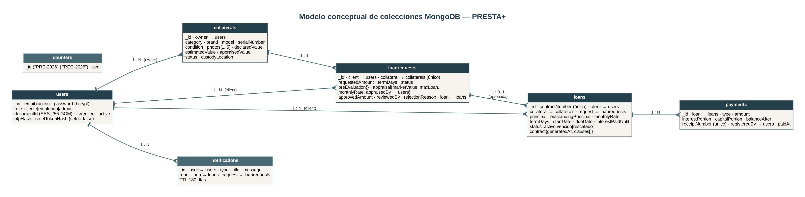

<div class="cover">
<p class="uni">UNIVERSIDAD ADVENTISTA DE BOLIVIA<br>INGENIERÍA DE SISTEMAS</p>
<p class="subj">Tecnologías en Internet · Proyecto Integrador</p>
<h1 class="title">PRESTA+</h1>
<p class="sub">Plataforma inteligente de préstamos prendarios</p>
<p class="deliv">Segunda Entrega: Producto Implementado y Repositorio GitHub</p>
<div class="repo"><strong>Repositorio público en GitHub</strong><br><a href="https://github.com/&lt;USUARIO&gt;/presta-plus">https://github.com/&lt;USUARIO&gt;/presta-plus</a><br><span class="note">Reemplace &lt;USUARIO&gt; por la cuenta/organización donde se publicó el repositorio.</span></div>
<table class="meta">
<tr><th>Integrantes</th><td>Fidel Jairo Flores Arratia<br>Alvaro Felix Condori Cerda<br>Yamil Pedro Ramos Huanca<br>Mijael Emerson Vega Orellana</td></tr>
<tr><th>Ayuda</th><td>Ing. Victor Hugo Sarzuri Flores</td></tr>
<tr><th>Asignatura</th><td>Tecnologías en Internet</td></tr>
<tr><th>Fecha</th><td>Noviembre de 2026</td></tr>
<tr><th>Versión</th><td>v2.0 (continúa la Especificación Técnica y de Diseño v1.1)</td></tr>
</table>
</div>
<div class="pb"></div>

## 1. Carátula e Información General

| Campo | Detalle |
|---|---|
| Proyecto | PRESTA+ · Plataforma inteligente de préstamos prendarios |
| Entrega | Segunda Entrega · Producto implementado y repositorio GitHub |
| Integrantes | Fidel Jairo Flores Arratia, Alvaro Felix Condori Cerda, Yamil Pedro Ramos Huanca, Mijael Emerson Vega Orellana |
| Ayuda | Ing. Victor Hugo Sarzuri Flores |
| Asignatura | Tecnologías en Internet · Ingeniería de Sistemas · Universidad Adventista de Bolivia |
| Fecha | Noviembre de 2026 |
| **Repositorio público (GitHub)** | **https://github.com/<USUARIO>/presta-plus** |
| Documentación interactiva (Swagger UI) | `http://localhost:4000/api-docs` (local) · `https://<URL-DE-LA-API>/api-docs` (producción) |
| Prototipo de diseño (Primera Entrega) | https://clear-flock-99112571.figma.site/ |

## 2. Resumen Ejecutivo y Alcance

**PRESTA+** digitaliza el ciclo completo de un préstamo prendario: el cliente registra su garantía con fotografías y recibe una **estimación inmediata**; un empleado tasador evalúa el bien, fija la tasa y aprueba la solicitud, lo que genera un **contrato digital**; luego se registran abonos, pagos de interés, renovaciones y el **rescate** de la garantía con comprobante, mientras el sistema controla la **custodia** y los **vencimientos** y notifica a los usuarios.

En esta segunda entrega se pasó del diseño y la ingeniería de requisitos (Primera Entrega: Figma, casos de uso CU-02/03/05 y C4 nivel 1) a un **sistema web funcional con arquitectura cliente-servidor desacoplada (MERN)**.

### 2.1 Alcance alcanzado

| Área | Entregado |
|---|---|
| Requisitos funcionales | Los **14 RF** (RF-001 a RF-014) de la especificación v1.1 están implementados de extremo a extremo (ver sección 3) |
| Casos de uso | **CU-02** (solicitar préstamo y registrar garantía), **CU-03** (evaluar y aprobar) y **CU-05** (pago, renovación y rescate) operativos |
| Roles | `cliente`, `empleado`, `admin` con RBAC en backend (middleware) y en el router del frontend |
| Persistencia | 7 colecciones MongoDB con Mongoose: validadores, referencias e índices |
| Seguridad | JWT (60 min), bcrypt (salt ≥ 10), AES-256-GCM para datos sensibles, Helmet, CORS, *rate limiting*, validación por lista blanca |
| API | **40 operaciones REST** documentadas en OpenAPI 3.0 / Swagger UI y colección Postman |
| Frontend | SPA responsive (Desktop 1440 px y Mobile 375/390 px) con los tokens del sistema de diseño de Figma |
| Calidad | 23 pruebas automatizadas (reglas de negocio, RBAC, validación, cifrado, contrato OpenAPI) y CI en GitHub Actions |

### 2.2 Tecnologías integradas

| Capa | Tecnología |
|---|---|
| Frontend | React 18, Vite 5, Tailwind CSS 3, React Router 6 (fetch nativo, sin dependencias de UI) |
| Backend | Node.js ≥ 18, Express 4, Mongoose 8, jsonwebtoken, bcryptjs, multer, nodemailer, helmet, express-rate-limit |
| Base de datos | MongoDB 7 (local con Docker o MongoDB Atlas) |
| Documentación | swagger-ui-express (OpenAPI 3.0.3), colección Postman, diagramas C4 y de secuencia |
| Calidad / DevOps | `node:test`, GitHub Actions, Docker Compose (MongoDB local) |

### 2.3 Límites declarados del alcance

- Los **pagos se registran en caja** por el empleado (como define CU-05); no hay pasarela de pago en línea.
- El **TLS 1.3** (RNF-002) se termina en el proveedor de despliegue o proxy inverso; la aplicación fuerza cabeceras seguras con Helmet.
- Las **fotografías** se guardan en el sistema de archivos del servidor (volumen); para producción en múltiples instancias se recomienda un almacenamiento de objetos (S3/Cloudinary).
- El envío de correo usa SMTP configurable; sin SMTP el OTP se imprime en consola (modo desarrollo).

## 3. Trazabilidad de Requisitos

### 3.1 Matriz de trazabilidad RF → componentes → endpoints

| Código | Descripción del requisito | Componente Frontend (React) | Endpoint / Servicio Backend | Implementación backend |
|---|---|---|---|---|
| RF-001 | Registro de clientes con verificación OTP por correo | `<Register />`, `<VerifyOtp />` | `POST /api/auth/register`, `POST /api/auth/verify-otp`, `POST /api/auth/resend-otp` | `authController`, modelo `User` (`otpHash`), `mailer` |
| RF-002 | Autenticación y acceso según rol | `<Login />`, `AuthContext`, `<ProtectedRoute />` | `POST /api/auth/login`, `GET /api/auth/me` | `auth.js` (JWT), `rbac.js`, `bcryptjs` |
| RF-003 | Recuperación de cuenta | `<ForgotPassword />`, `<ResetPassword />` | `POST /api/auth/forgot-password`, `POST /api/auth/reset-password` | `authController` (token con hash SHA-256 y expiración) |
| RF-004 | Registro de garantía (categoría, marca, modelo, serie/IMEI, estado, descripción, fotos) | `<NewRequest />` (pasos 1-2), `<PhotoUploader />` | `POST/GET /api/collaterals`, `GET/PUT/DELETE /api/collaterals/{id}` | `collateralController`, modelo `Collateral`, `upload.js` (multer) |
| RF-005 | Pre-evaluación del préstamo | `<NewRequest />` (panel «Estimación inicial») | `POST /api/collaterals/pre-evaluation` | `loanCalculator.preEvaluate` |
| RF-006 | Tasación del empleado (valor, monto máximo, tasa) | `<RequestDetail />` | `PATCH /api/loan-requests/{id}/appraisal` | `loanCalculator.appraise` |
| RF-007 | Gestión de solicitudes (consultar, aprobar, rechazar) | `<RequestsList />`, `<RequestDetail />` | `GET/POST /api/loan-requests`, `PATCH …/approve`, `PATCH …/reject` | `loanRequestController`, `loanService.approveRequest` |
| RF-008 | Contrato digital | `<LoanDetail />` (pestaña Contrato) | `GET /api/loans/{id}/contract` | `loanService.buildClauses`, `Loan.contract` |
| RF-009 | Estado de préstamos, saldo, vencimientos y operaciones | `<ClientHome />`, `<LoansList />`, `<LoanDetail />` | `GET /api/loans`, `GET /api/loans/{id}`, `…/quote`, `…/payments` | `loanController`, `loanCalculator.quote` |
| RF-010 | Abonos, intereses, renovación y rescate con comprobante | `<PaymentForm />`, `<PaymentsList />` (comprobante) | `POST /api/loans/{id}/payments`, `GET /api/payments`, `GET /api/payments/{id}` | `loanService.registerPayment`, `loanCalculator.applyPayment`, modelo `Payment` |
| RF-011 | Custodia, próximos a vencer y vencidos | `<Custody />`, `<LoansList />` (pestañas) | `GET /api/loans/custody`, `GET /api/loans?dueSoon=true`, `?status=vencido` | `loanService.syncLoanStatuses` (job cada 30 min) |
| RF-012 | Notificaciones | `<Notifications />`, contador en `<Layout />` | `GET /api/notifications`, `PATCH …/read`, `PATCH …/read-all`, `GET …/unread-count` | `notify`, modelo `Notification` (TTL 180 días) |
| RF-013 | Dashboard administrativo | `<StaffDashboard />` | `GET /api/dashboard/summary` | `dashboardController` (agregaciones) |
| RF-014 | Perfil y cambio de contraseña | `<Profile />` | `PUT /api/users/me`, `PATCH /api/users/me/password` | `userController` |
| Entrega 2 | Documentación interactiva de la API | `<ApiDocs />` (ruta `/panel/api-docs`) | `GET /api-docs` (Swagger UI), `GET /api-docs.json` | `swagger-ui-express`, `docs/openapi.js` |

### 3.2 Validación de requisitos no funcionales (RNF)

| RNF | Criterio (Especificación v1.1 / guía 2.ª entrega) | Cómo se cumple en el código | Verificación |
|---|---|---|---|
| **RNF-001** Rendimiento backend | Lecturas < 200 ms (v1.1); objetivo < 150 ms en consultas estándar (guía) | Índices compuestos alineados con cada consulta (§5.3), paginación obligatoria (máx. 100), `Promise.all` para consultas independientes, agregaciones en MongoDB | Medir con la colección Postman (*Runner*) o `curl -w "%{time_total}"` sobre `GET /api/loans` y `GET /api/loan-requests` en el entorno desplegado |
| **RNF-001** Rendimiento frontend | Carga < 2 s, 100 % responsive | Build con Vite (minificado y *tree-shaking*), Tailwind purgado, sin librerías de UI, fuente Inter con `display=swap`, diseño *mobile-first* | `npm run build` + Lighthouse sobre `vite preview` |
| **RNF-002** Seguridad | Contraseñas con hash robusto; JWT con expiración configurable (60 min); HTTPS/TLS 1.3; AES-256 en reposo | **bcryptjs** con salt = `BCRYPT_SALT_ROUNDS` (≥ 10, forzado por `Math.max`); **JWT HS256** con `JWT_SECRET` ≥ 32 car. y `JWT_EXPIRES_IN=60m`; **AES-256-GCM** para `documentId`; Helmet; *rate limit* en login/OTP; OTP y tokens de recuperación guardados solo como hash | Pruebas `security.test.js` (cifrado, RBAC, validación); TLS 1.3 lo provee el hosting/proxy |
| **RNF-003** Accesibilidad | WCAG 2.1 AA: contraste ≥ 4.5:1, navegación por teclado | Tokens de Figma con variantes `-700` para texto (tabla abajo); foco visible, enlace «Saltar al contenido», etiquetas asociadas, `aria-live`/`role="alert"`, modales con foco y `Esc`, objetivos táctiles ≥ 44 px, `prefers-reduced-motion` | Contrastes calculados con la fórmula WCAG; revisión con axe DevTools |
| **RNF-004** Compatibilidad | Responsive Desktop 1440 px y Mobile 375/390 px; Chrome, Firefox, Safari, Edge | Layout con barra lateral (≥ 1024 px) y menú desplegable en móvil; tablas con *scroll* horizontal; CSS estándar con Autoprefixer | Pruebas manuales en los 4 navegadores y viewports 375/390/1440 |
| **RNF-005** Disponibilidad | 99.5 % en horario comercial con recuperación ante fallos | `GET /api/health` (estado de BD) para monitoreo, cierre ordenado (SIGTERM), reconexión automática del driver, mantenimiento programado tolerante a errores, errores 5xx sin filtrar detalles | Configurar el *health check* y reinicio automático en el proveedor (Render/Railway/PM2) |

**Contrastes de color (WCAG 2.1) de los tokens del sistema de diseño**

| Combinación | Ratio | ¿AA texto normal (4.5:1)? | Uso en la UI |
|---|---|---|---|
| `Brand/Primary-600 #23404A` sobre blanco | 11.03:1 | Sí | Títulos, botón primario (texto blanco sobre fondo) |
| `Neutral/Dark-900 #30383B` sobre `#F5F3EE` | 10.79:1 | Sí | Texto principal sobre el fondo de la app |
| `Brand/Secondary-500 #496A73` sobre blanco | 5.85:1 | Sí | Bordes, iconos, texto secundario de apoyo |
| `ink-600 #5B686C` sobre `#F5F3EE` | 5.20:1 | Sí | Texto de ayuda y metadatos |
| `Semantic/Success-500 #5F8068` sobre blanco | 4.40:1 | **No** (solo gráficos) | Se usa `success-700 #3F5B48` para texto (7.50:1) |
| `Semantic/Warning-500 #B8755C` sobre blanco | 3.66:1 | **No** | Se usa `warning-700 #8A4A33` para texto (6.76:1) |
| `Semantic/Error-500 #A65D5D` sobre blanco | 4.83:1 | Sí | Bordes y alertas; texto con `danger-700 #7E3F3F` (7.87:1) |

## 4. Arquitectura del Sistema

### 4.1 Diagrama C4 Nivel 2 (Contenedores)



| Contenedor | Tecnología | Responsabilidad |
|---|---|---|
| **SPA Cliente** | React 18 + Vite + Tailwind | Portal del cliente (`/app`) y panel del personal (`/panel`); mantiene el JWT en `AuthContext`; guardas de ruta por rol; consume la API con `Authorization: Bearer` |
| **API REST** | Node.js + Express | Autenticación JWT, RBAC, validación, reglas de negocio (tasación, interés, pagos), notificaciones, Swagger UI (`/api-docs`) y servicio de imágenes (`/uploads`) |
| **Base de datos** | MongoDB 7 / Atlas + Mongoose | Persistencia documental de 7 colecciones con validadores e índices |
| **Almacén de imágenes** | Sistema de archivos (volumen) | Fotografías de garantías con nombre aleatorio (16 bytes) |
| **Servicio de correo** *(externo)* | SMTP | Envío de OTP y enlaces de recuperación |

Coherencia con la Primera Entrega: el C4 nivel 1 definía a PRESTA+ como un sistema con dos tipos de usuarios y un servicio de correo externo; este nivel 2 descompone el sistema en los contenedores que realmente se implementaron.

### 4.2 Diagrama de secuencia de autenticación y autorización (JWT)



**Flujo.** (A) El SPA envía `POST /api/auth/login`; la API valida la entrada, busca el usuario con `select('+password')`, compara con `bcrypt.compare` y, si es válido, firma un JWT `HS256` con `{ sub, role }`, emisor `presta-plus` y expiración de 60 min. El SPA almacena el token y el usuario en `AuthContext`. (B) En cada petición protegida envía `Authorization: Bearer <JWT>`; `authenticate` verifica firma, algoritmo, emisor y expiración y recarga al usuario (para respetar desactivaciones); `authorize(...roles)` aplica el RBAC. Ante 401 el SPA limpia la sesión y redirige a `/login`.

**Decisiones de seguridad:** mensajes de credenciales genéricos y *hash* ficticio para igualar tiempos (evita enumeración de cuentas); `algorithms: ['HS256']` fijo en la verificación; el rol del token no se usa como única fuente de verdad (se consulta al usuario vigente).

### 4.3 Matriz de permisos (RBAC)

| Capacidad | cliente | empleado | admin |
|---|:-:|:-:|:-:|
| Registrar, editar y eliminar sus garantías; pre-evaluar | ✔ | pre-evaluar | pre-evaluar |
| Enviar solicitudes de préstamo | ✔ | — | — |
| Ver solicitudes, garantías y préstamos | propios | todos | todos |
| Tasar, aprobar y rechazar solicitudes | — | ✔ | ✔ |
| Registrar pagos, renovaciones y rescates | — | ✔ | ✔ |
| Custodia y dashboard administrativo | — | ✔ | ✔ |
| Gestionar usuarios (alta de personal, activar/desactivar) | — | — | ✔ |
| Perfil, notificaciones, cambio de contraseña | ✔ | ✔ | ✔ |

La autorización se aplica en **dos niveles**: por rol (`authorize`) y por **propiedad del recurso** en los controladores (un cliente recibe 403 al consultar el préstamo de otro).

### 4.4 Estructura de capas del backend

`routes` (verbo + ruta + validación + RBAC) → `controllers` (orquestación HTTP) → `services` y `utils/loanCalculator` (reglas de negocio puras y probadas) → `models` (Mongoose). Un manejador de errores único (`errorHandler`) normaliza todas las respuestas de error a `{ success:false, message, code, details? }`.

## 5. Diseño de Persistencia en MongoDB

### 5.1 Colecciones y relaciones conceptuales



| Colección | Propósito | Campos clave y relaciones |
|---|---|---|
| `users` | Cuentas de cliente, empleado y admin | `email` único, `password` (hash bcrypt, `select:false`), `role`, `documentId` (AES-256-GCM), `isVerified`, `active`; OTP y token de recuperación solo como hash |
| `collaterals` | Garantías | `owner → users`, `category`, `brand`, `model`, `serialNumber`, `condition`, `photos[1..5]`, `declaredValue`, `estimatedValue`, `appraisedValue`, `status`, `custodyLocation` |
| `loanrequests` | Solicitudes | `client → users`, `collateral → collaterals` (único), `requestedAmount`, `termDays`, `status`, `preEvaluation{}`, `appraisal{}`, `reviewedBy`, `loan → loans` |
| `loans` | Préstamos y contrato digital | `contractNumber` único, `client`, `collateral`, `request`, `principal`, `outstandingPrincipal`, `monthlyRate`, `dueDate`, `interestPaidUntil`, `status`, `contract{generatedAt, clauses[]}` |
| `payments` | Operaciones y comprobantes | `loan → loans`, `type`, `amount`, `interestPortion`, `capitalPortion`, `balanceAfter`, `receiptNumber` único, `registeredBy → users` |
| `notifications` | Bandeja de avisos | `user → users`, `type`, `title`, `message`, `read`, `loan`, `request` |
| `counters` | Numeración correlativa atómica | `_id` = `PRE-2026` / `REC-2026`, `seq` (`$inc` atómico) |

**Decisiones de modelado.** Se **referencian** (no se incrustan) usuarios, garantías, solicitudes y préstamos porque tienen ciclo de vida y consultas independientes; se **incrustan** los datos que no existen fuera de su documento padre: `photos` en la garantía, `appraisal` y `preEvaluation` en la solicitud, y `contract` en el préstamo (el contrato queda como una instantánea inmutable de las condiciones pactadas). Los saldos se guardan desnormalizados (`outstandingPrincipal`, `interestPaidUntil`) y el interés se calcula al vuelo, evitando tareas diarias de acumulación.

### 5.2 Validaciones de esquema Mongoose

| Aspecto | Implementación |
|---|---|
| Obligatoriedad y longitudes | `required` con mensajes en español, `minlength/maxlength`, `trim` |
| Formatos | `match` para correo y teléfono; `lowercase` en correo; `uppercase` en serie/IMEI |
| Dominios cerrados | `enum` para `role`, `category`, `condition`, estados y tipos de pago |
| Rangos | `min` en montos (> 0), plazo 7–180 días |
| Colecciones | Validador personalizado: de 1 a 5 fotografías por garantía |
| Unicidad | Índices únicos: `users.email`, `loans.contractNumber`, `payments.receiptNumber`, `loanrequests.collateral` |
| Entrada HTTP | Middleware `validate` por lista blanca (descarta campos no declarados y rechaza objetos → previene *mass-assignment* e inyección de operadores `$`) |
| Datos sensibles | `select:false` en hash de contraseña, OTP y tokens; `documentId` cifrado con setter/getter AES-256-GCM |
| Unicidad de negocio | Una garantía con serie/IMEI activa no puede registrarse dos veces (verificación en el controlador) |

### 5.3 Índices definidos y su justificación

| Colección | Índice | Consulta que optimiza |
|---|---|---|
| `users` | `{ email: 1 }` único | Login y verificación de duplicados |
| `users` | `{ role: 1, active: 1 }` | Listado administrativo filtrado |
| `users` | `{ resetTokenHash: 1 }` *sparse* | Restablecimiento de contraseña |
| `collaterals` | `{ owner: 1, status: 1 }` | «Mis garantías» por estado |
| `collaterals` | `{ status: 1, createdAt: -1 }` | Listados del personal |
| `collaterals` | `{ serialNumber: 1 }` | Detección de duplicados |
| `loanrequests` | `{ client: 1, createdAt: -1 }` | «Mis solicitudes» |
| `loanrequests` | `{ status: 1, createdAt: -1 }` | Cola de evaluación (pendientes más antiguas) |
| `loanrequests` | `{ collateral: 1 }` único | Una solicitud por garantía |
| `loans` | `{ client: 1, status: 1 }` | Portal del cliente |
| `loans` | `{ status: 1, dueDate: 1 }` | Vencidos y por vencer (RF-011), job de estados |
| `loans` | `{ contractNumber: 1 }` único | Búsqueda por contrato |
| `payments` | `{ loan: 1, paidAt: -1 }` | Historial de un préstamo |
| `payments` | `{ paidAt: -1 }` | Registro de pagos y agregaciones del dashboard |
| `notifications` | `{ user: 1, read: 1, createdAt: -1 }` | Bandeja y contador de no leídas |
| `notifications` | `{ createdAt: 1 }` TTL 180 días | Depuración automática |

**Consistencia.** Se evitaron transacciones multi-documento para soportar MongoDB standalone local; las operaciones críticas se ordenan para que un fallo intermedio sea recuperable (p. ej. si la solicitud falla tras crear la garantía, esta queda en estado `registrada` y el cliente puede reintentar) y los contadores usan `$inc` atómico. Con un *replica set* (Atlas) se pueden envolver en `session.withTransaction` como mejora futura.

## 6. Especificación de Endpoints y API REST

**Convenciones.** Base: `/api`. Autenticación: `Authorization: Bearer <JWT>` (salvo rutas públicas). Éxito: `{ success:true, data, meta? }`; error: `{ success:false, message, code, details? }`. Paginación: `page` (≥ 1) y `limit` (máx. 100) con `meta { page, limit, total, pages }`. Códigos usados: **200** OK, **201** creado, **204** sin contenido, **400** validación, **401** no autenticado/token vencido, **403** sin permiso (RBAC o recurso ajeno), **404** no encontrado, **409** conflicto de estado/duplicado, **422** regla de negocio, **429** límite de peticiones.

### 6.1 Matriz de endpoints (40 operaciones)

**Sistema**

| Método | Ruta | Roles (RBAC) | Descripción | Parámetros | HTTP |
|---|---|---|---|---|---|
| `GET` | `/api/health` | público | Estado del servicio y de la base de datos | — | 200 |

**Autenticación**

| Método | Ruta | Roles (RBAC) | Descripción | Parámetros | HTTP |
|---|---|---|---|---|---|
| `POST` | `/api/auth/register` | público | Registrar cliente y enviar OTP por correo (RF-001) | Body: **firstName**, **lastName**, **email**, **password**, **documentId** ; opc.: phone, address | 201, 400, 409, 429 |
| `POST` | `/api/auth/verify-otp` | público | Verificar OTP y abrir sesión (RF-001) | Body: **email**, **code** | 200, 400, 429 |
| `POST` | `/api/auth/resend-otp` | público | Reenviar código OTP | Body: **email** | 200, 400, 429 |
| `POST` | `/api/auth/login` | público | Iniciar sesión y obtener JWT (RF-002) | Body: **email**, **password** | 200, 400, 401, 403, 429 |
| `POST` | `/api/auth/forgot-password` | público | Solicitar restablecimiento de contraseña (RF-003) | Body: **email** | 200, 400, 429 |
| `POST` | `/api/auth/reset-password` | público | Restablecer contraseña con token (RF-003) | Body: **email**, **token**, **password** | 200, 400, 429 |
| `GET` | `/api/auth/me` | cliente, empleado, admin | Usuario de la sesión activa (RF-002) | — | 200, 401 |

**Usuarios**

| Método | Ruta | Roles (RBAC) | Descripción | Parámetros | HTTP |
|---|---|---|---|---|---|
| `PUT` | `/api/users/me` | cliente, empleado, admin | Actualizar perfil propio (RF-014) | Body:  ; opc.: firstName, lastName, phone, address, documentId | 200, 400, 401 |
| `PATCH` | `/api/users/me/password` | cliente, empleado, admin | Cambiar contraseña (RF-014) | Body: **currentPassword**, **newPassword** | 200, 400, 401, 422 |
| `GET` | `/api/users` | admin | Listar usuarios (administración) | Query: `role`, `active`, `q`<br>Paginación: `page`, `limit` | 200, 401, 403 |
| `POST` | `/api/users/staff` | admin | Crear empleado o administrador | Body: **firstName**, **lastName**, **email**, **password**, **role** ; opc.: phone | 201, 400, 401, 403, 409 |
| `PATCH` | `/api/users/{id}/active` | admin | Activar o desactivar una cuenta | Ruta: `id`<br>Body: **active** | 200, 400, 401, 403, 404, 422 |

**Garantías**

| Método | Ruta | Roles (RBAC) | Descripción | Parámetros | HTTP |
|---|---|---|---|---|---|
| `POST` | `/api/collaterals/pre-evaluation` | cliente, empleado, admin | Pre-evaluar garantía: valor y préstamo estimado (RF-005) | Body: **category**, **condition**, **declaredValue** | 200, 400, 401 |
| `POST` | `/api/collaterals` | cliente | Registrar garantía con fotografías (RF-004) | Body: **category**, **brand**, **model**, **serialNumber**, **condition**, **declaredValue**, **photos** ; opc.: description | 201, 400, 401, 403, 409 |
| `GET` | `/api/collaterals` | cliente, empleado, admin | Listar garantías (propias para clientes; todas para personal) | Query: `status`, `category`, `q`<br>Paginación: `page`, `limit` | 200, 401 |
| `GET` | `/api/collaterals/{id}` | cliente, empleado, admin | Detalle de una garantía | Ruta: `id` | 200, 400, 401, 403, 404 |
| `PUT` | `/api/collaterals/{id}` | cliente | Editar garantía registrada (antes de solicitar) | Ruta: `id`<br>Body:  ; opc.: category, brand, model, serialNumber, condition, description, declaredValue | 200, 400, 401, 403, 404, 409 |
| `DELETE` | `/api/collaterals/{id}` | cliente | Eliminar garantía registrada (antes de solicitar) | Ruta: `id` | 204, 400, 401, 403, 404, 409 |

**Solicitudes**

| Método | Ruta | Roles (RBAC) | Descripción | Parámetros | HTTP |
|---|---|---|---|---|---|
| `POST` | `/api/loan-requests` | cliente | Enviar solicitud de préstamo (CU-02) | Body: **collateralId**, **requestedAmount** ; opc.: termDays | 201, 400, 401, 403, 404, 409, 422 |
| `GET` | `/api/loan-requests` | cliente, empleado, admin | Listar solicitudes (RF-007) | Query: `status`<br>Paginación: `page`, `limit` | 200, 401 |
| `GET` | `/api/loan-requests/{id}` | cliente, empleado, admin | Detalle de solicitud | Ruta: `id` | 200, 400, 401, 403, 404 |
| `PATCH` | `/api/loan-requests/{id}/appraisal` | empleado, admin | Registrar tasación: monto máximo y tasa (RF-006) | Ruta: `id`<br>Body: **marketValue** | 200, 400, 401, 403, 404, 409 |
| `PATCH` | `/api/loan-requests/{id}/approve` | empleado, admin | Aprobar solicitud y generar contrato (CU-03, RF-007/008) | Ruta: `id`<br>Body: **approvedAmount** ; opc.: termDays, custodyLocation | 200, 400, 401, 403, 404, 409, 422 |
| `PATCH` | `/api/loan-requests/{id}/reject` | empleado, admin | Rechazar solicitud con motivo (RF-007) | Ruta: `id`<br>Body: **reason** | 200, 400, 401, 403, 404, 409 |

**Préstamos**

| Método | Ruta | Roles (RBAC) | Descripción | Parámetros | HTTP |
|---|---|---|---|---|---|
| `GET` | `/api/loans` | cliente, empleado, admin | Listar préstamos con saldo e interés vigentes (RF-009, RF-011) | Query: `status`, `dueSoon`, `q`<br>Paginación: `page`, `limit` | 200, 401 |
| `GET` | `/api/loans/custody` | empleado, admin | Garantías en custodia (RF-011) | Paginación: `page`, `limit` | 200, 401, 403 |
| `GET` | `/api/loans/{id}` | cliente, empleado, admin | Detalle del préstamo con cotización (RF-009) | Ruta: `id` | 200, 400, 401, 403, 404 |
| `GET` | `/api/loans/{id}/quote` | cliente, empleado, admin | Cotización: interés devengado y monto de rescate | Ruta: `id` | 200, 400, 401, 403, 404 |
| `GET` | `/api/loans/{id}/contract` | cliente, empleado, admin | Contrato digital (RF-008) | Ruta: `id` | 200, 400, 401, 403, 404 |

**Pagos**

| Método | Ruta | Roles (RBAC) | Descripción | Parámetros | HTTP |
|---|---|---|---|---|---|
| `GET` | `/api/loans/{id}/payments` | cliente, empleado, admin | Historial de operaciones del préstamo (RF-009) | Ruta: `id` | 200, 400, 401, 403, 404 |
| `POST` | `/api/loans/{id}/payments` | empleado, admin | Registrar abono, pago de interés, renovación o rescate (CU-05, RF-010) | Ruta: `id`<br>Body: **type**, **amount** ; opc.: note | 201, 400, 401, 403, 404, 409, 422 |
| `GET` | `/api/payments` | cliente, empleado, admin | Registro de pagos (propios para clientes; todos para personal) | Query: `type`<br>Paginación: `page`, `limit` | 200, 401 |
| `GET` | `/api/payments/{id}` | cliente, empleado, admin | Comprobante digital de un pago (RF-010) | Ruta: `id` | 200, 400, 401, 403, 404 |

**Notificaciones**

| Método | Ruta | Roles (RBAC) | Descripción | Parámetros | HTTP |
|---|---|---|---|---|---|
| `GET` | `/api/notifications` | cliente, empleado, admin | Listar notificaciones propias (RF-012) | Query: `unread`<br>Paginación: `page`, `limit` | 200, 401 |
| `GET` | `/api/notifications/unread-count` | cliente, empleado, admin | Cantidad de notificaciones sin leer | — | 200, 401 |
| `PATCH` | `/api/notifications/read-all` | cliente, empleado, admin | Marcar todas como leídas | — | 200, 401 |
| `PATCH` | `/api/notifications/{id}/read` | cliente, empleado, admin | Marcar una notificación como leída | Ruta: `id` | 200, 400, 401, 404 |

**Dashboard**

| Método | Ruta | Roles (RBAC) | Descripción | Parámetros | HTTP |
|---|---|---|---|---|---|
| `GET` | `/api/dashboard/summary` | empleado, admin | Resumen administrativo (RF-013) | — | 200, 401, 403 |
| `GET` | `/api/dashboard/me` | cliente | Resumen del portal del cliente | — | 200, 401, 403 |

### 6.2 Reglas de negocio expuestas por la API

| Regla | Detalle |
|---|---|
| Pre-evaluación (RF-005) | `valor estimado = valor declarado × factor de estado` (excelente 0.80, bueno 0.65, regular 0.45, malo 0.25); `préstamo estimado = valor estimado × LTV` por categoría (joyas 70 %, vehículos 60 %, electrónica y herramientas 50 %, otros 40 %) |
| Tasación (RF-006) | `monto máximo = valor de mercado × LTV`; tasa mensual por categoría (vehículos 2.5 %, joyas 3 %, herramientas 3.5 %, electrónica 4 %, otros 4.5 %) |
| Aprobación (RF-007) | Requiere tasación previa; `monto aprobado ≤ monto máximo` (si no, **422**); crea préstamo con contrato `PRE-AAAA-NNNNNN`, pone la garantía en custodia y notifica al cliente |
| Interés | Simple, base 30 días: `capital × tasa mensual × días / 30` desde `interestPaidUntil` |
| Pago de interés / renovación | El monto debe igualar el interés devengado; la renovación extiende el vencimiento un plazo completo (desde hoy si ya estaba vencido) y reactiva el préstamo |
| Abono a capital | Se aplica primero al interés devengado; el excedente reduce el capital; si liquida el capital → **422** (usar rescate) |
| Rescate | El monto debe igualar capital + interés; el préstamo pasa a `rescatado` y la garantía a `rescatada` |
| Vencimientos (RF-011/012) | Tarea cada 30 min: marca `vencido` y notifica; avisa 7 días antes del vencimiento (una sola vez por plazo) |

### 6.3 Documentación interactiva (Swagger UI)

La API publica su especificación **OpenAPI 3.0.3** con esquemas, ejemplos, respuestas de error, seguridad Bearer y el campo `x-roles` por operación.

| Recurso | Ubicación |
|---|---|
| Swagger UI interactivo | `http://localhost:4000/api-docs` (botón **Authorize** para pegar el JWT) |
| Especificación JSON | `http://localhost:4000/api-docs.json` y `docs/openapi.json` |
| Colección Postman | `docs/postman/PRESTA+.postman_collection.json` (guarda el token automáticamente tras `login`) |
| Vista dentro del SPA | Ruta `/panel/api-docs` (iframe de Swagger UI) |

> **Captura de Swagger UI:** tras levantar la API (sección 8), abra `/api-docs`, autentíquese con **Authorize** y guarde la captura en `docs/screenshots/swagger-ui.png`; referénciela aquí si su docente solicita la imagen además del enlace.

## 7. Configuración de Entorno y Variables

Existe un `.env.example` en la raíz, en `server/` y en `client/`. **Los archivos `.env` reales están excluidos por `.gitignore`.**

### 7.1 Backend (`server/.env`)

| Variable | Descripción | Local | Producción |
|---|---|---|---|
| `NODE_ENV` | Modo de ejecución | `development` | `production` |
| `PORT` | Puerto HTTP | `4000` | Asignado por la plataforma |
| `CLIENT_URL` | Origen(es) del frontend permitidos por CORS (coma) | `http://localhost:5173` | `https://app.su-dominio.com` |
| `MONGODB_URI` | Cadena de conexión | `mongodb://127.0.0.1:27017/prestamas` | `mongodb+srv://<usuario>:<clave>@<cluster>/prestamas` (secreto) |
| `JWT_SECRET` | Clave de firma JWT (≥ 32 car.) | Aleatoria de 48 bytes | Distinta a la local, en el gestor de secretos |
| `JWT_EXPIRES_IN` | Expiración del token (RNF-002) | `60m` | `60m` |
| `BCRYPT_SALT_ROUNDS` | Costo de bcrypt (mín. 10 forzado) | `10` | `10`–`12` |
| `ENCRYPTION_KEY` | Clave AES-256 (64 hex) para datos sensibles | Aleatoria de 32 bytes | Distinta, con respaldo seguro |
| `OTP_TTL_MINUTES` / `RESET_TOKEN_TTL_MINUTES` | Vigencia del OTP y del enlace de recuperación | `10` / `30` | `10` / `30` |
| `DEV_EXPOSE_CODES` | Devuelve OTP/token en la respuesta (solo desarrollo) | `true` | **`false`** (la API se niega a arrancar si es `true` en producción) |
| `SMTP_HOST`, `SMTP_PORT`, `SMTP_SECURE`, `SMTP_USER`, `SMTP_PASS`, `SMTP_FROM` | Servidor de correo | vacío (correos a consola) | Credenciales del proveedor SMTP |
| `UPLOAD_DIR`, `MAX_UPLOAD_MB` | Carpeta y tamaño máximo de imágenes | `uploads`, `5` | Volumen persistente, `5` |
| `RATE_LIMIT_MAX`, `AUTH_RATE_LIMIT_MAX` | Peticiones por 15 min (general / autenticación) | `300` / `20` | Ajustar según tráfico |
| `SEED_*_PASSWORD` | Contraseñas de cuentas demo del *seed* | Valores del README | **No ejecutar el seed en producción** |

El servidor **falla rápido** al iniciar si falta `MONGODB_URI`, si `JWT_SECRET` tiene menos de 32 caracteres o si `ENCRYPTION_KEY` no es hexadecimal de 64 caracteres.

### 7.2 Frontend (`client/.env`)

| Variable | Descripción | Local | Producción |
|---|---|---|---|
| `VITE_API_URL` | URL base de la API | vacío (el proxy de Vite redirige `/api`) | `https://api.su-dominio.com/api` |
| `VITE_DEV_PROXY_TARGET` | Destino del proxy de desarrollo | `http://localhost:4000` | No aplica |

Las variables `VITE_*` se incrustan en el *bundle*: **nunca** deben contener secretos.

## 8. Manual de Ejecución y Pruebas

### 8.1 Requisitos previos
Node.js 18.18+ (recomendado 20 LTS) y npm · Git · MongoDB local (Docker Desktop) **o** clúster gratuito de MongoDB Atlas · Navegador moderno.

### 8.2 Instalación y ejecución local

```bash
# 1. Clonar e instalar dependencias
git clone https://github.com/<USUARIO>/presta-plus.git
cd presta-plus
npm run install:all

# 2. Base de datos local (o use la URI de Atlas en server/.env)
docker compose up -d

# 3. Variables de entorno
cp server/.env.example server/.env
cp client/.env.example client/.env
node -e "console.log('JWT_SECRET='+require('crypto').randomBytes(48).toString('hex'))"
node -e "console.log('ENCRYPTION_KEY='+require('crypto').randomBytes(32).toString('hex'))"
# → pegar ambos valores en server/.env

# 4. Datos de demostración (opcional)
npm run seed

# 5. Ejecutar (dos terminales)
npm run dev:server      # API  http://localhost:4000  ·  Swagger /api-docs
npm run dev:client      # SPA  http://localhost:5173
```

| Rol | Correo | Contraseña (solo desarrollo) |
|---|---|---|
| Administrador | `admin@prestamas.test` | `Admin#2026` |
| Empleado | `empleado@prestamas.test` | `Empleado#2026` |
| Cliente | `cliente@prestamas.test` | `Cliente#2026` |

El *seed* crea además un préstamo activo (Lenovo ThinkPad T14, 1 500 Bs) y una solicitud en evaluación (anillo de oro) para el cliente demo.

### 8.3 Construcción para producción
`npm run build` genera `client/dist` (publicable en Vercel, Netlify o Nginx). La API se despliega con `npm start` en Render/Railway/VPS, con las variables de la sección 7 y HTTPS en el proxy. Configure `CLIENT_URL` con el dominio exacto del frontend.

### 8.4 Pruebas automatizadas

```bash
npm test      # equivale a: cd server && node --test tests/*.test.js
```

| Archivo | Qué verifica |
|---|---|
| `loanCalculator.test.js` (10) | Pre-evaluación, tasación, interés devengado, vencido/por vencer, pago de interés, renovación (incluso con mora), abono, rescate y estados terminales |
| `security.test.js` (9) | RBAC (permitido, 403, 401), lista blanca y coerción, bloqueo de objetos tipo `{$gt:""}`, política de contraseñas, AES-256-GCM (cifrado distinto por operación y detección de manipulación), enmascarado |
| `openapi.test.js` (4) | Especificación OpenAPI 3.0 válida: toda operación con resumen, tag, `x-roles`, respuestas y 401; referencias `$ref` existentes |

**Resultado de la última ejecución: 23 de 23 pruebas aprobadas.** El workflow `.github/workflows/ci.yml` las ejecuta en cada *push* y compila el frontend.

### 8.5 Plan de pruebas funcionales (Swagger UI / Postman / navegador)

| ID | Caso | Pasos | Resultado esperado |
|---|---|---|---|
| T-01 | Registro y OTP (RF-001) | Registrar cliente; ingresar OTP de consola/pantalla | 201 en registro; 200 con JWT al verificar; acceso a `/app` |
| T-02 | OTP inválido | Ingresar un código erróneo | 400 `OTP_INVALID`; tras 5 intentos, 429 |
| T-03 | Login y RBAC (RF-002) | Login como cliente y llamar `GET /api/dashboard/summary` | 403 `FORBIDDEN` |
| T-04 | Token ausente/vencido | Llamar `GET /api/loans` sin token | 401 `AUTH_MISSING_TOKEN` |
| T-05 | Recuperación (RF-003) | Solicitar enlace, restablecer, iniciar sesión con la nueva clave | 200 genérico; 200; login correcto |
| T-06 | Pre-evaluación (RF-005) | `POST /collaterals/pre-evaluation` (electrónica, bueno, 3 500) | `estimatedValue` 2 275 · `estimatedLoan` 1 137.50 |
| T-07 | CU-02 Solicitar préstamo | Cliente: registrar garantía con 1-5 fotos y enviar solicitud | 201; estado `en_evaluacion`; sin fotos → 400 `PHOTOS_REQUIRED`; serie duplicada → 409 |
| T-08 | CU-03 Tasar y aprobar | Empleado: tasar 3 200 (electrónica), aprobar 1 500 | Máximo 1 600; aprobado → préstamo `PRE-AAAA-000001`, garantía `en_custodia`, notificación al cliente; 1 700 → 422 |
| T-09 | Rechazo | Rechazar con motivo | 200; el cliente ve el motivo; sin motivo → 400 |
| T-10 | CU-05 Pagos | Registrar `pago_interes`, `abono_capital`, `renovacion` | Montos exactos validados (422 si no coinciden); comprobante `REC-AAAA-NNNNNN`; saldo/vencimiento actualizados |
| T-11 | Rescate | Registrar `rescate` por capital + interés | Préstamo `rescatado`, garantía `rescatada`; nuevas operaciones → 409 |
| T-12 | Propiedad del recurso | Cliente A consulta `GET /loans/{id}` de cliente B | 403 |
| T-13 | Vencimientos (RF-011) | Ajustar `dueDate` en BD a una fecha pasada y consultar `GET /loans` | Estado `vencido` y notificación `prestamo_vencido` |
| T-14 | Responsive/accesibilidad | Navegar con solo teclado en 375 px y 1440 px | Foco visible, sin desbordes horizontales, tablas con *scroll* |
| T-15 | Documentación (RF Swagger) | Abrir `/api-docs`, **Authorize** con JWT y ejecutar `GET /auth/me` | 200 con el usuario autenticado |

## 9. Conclusiones y Trabajo Futuro

### 9.1 Conclusiones técnicas
- Se logró implementar **los 14 requisitos funcionales** de la especificación y mantener la trazabilidad completa entre requisito, componente React, endpoint y modelo de datos.
- La separación **SPA / API / base de datos** permitió desarrollar y probar cada capa de forma independiente; el contrato OpenAPI actúa como fuente de verdad y alimenta Swagger UI, Postman y las pruebas.
- Concentrar las reglas financieras en **funciones puras** (`loanCalculator`) facilitó una cobertura de pruebas alta sin necesidad de base de datos.
- La seguridad se diseñó **por capas**: validación por lista blanca, JWT + RBAC por rol y por propiedad, hash y cifrado de datos sensibles, límites de peticiones y manejo uniforme de errores sin filtrar detalles internos.
- Los tokens del sistema de diseño de Figma se trasladaron a Tailwind; el análisis de contraste obligó a definir variantes oscuras para texto semántico y cumplir WCAG AA.

### 9.2 Lecciones aprendidas
- Definir primero el **contrato de la API** (OpenAPI) evita retrabajo entre frontend y backend.
- Las reglas de dinero (interés, mora, rescate) deben **especificarse sin ambigüedad** (base de cálculo, redondeo, quién paga qué primero) antes de codificarse.
- Los datos sensibles y los secretos requieren política desde el inicio: `.gitignore`, `.env.example` y validación de configuración al arrancar.
- Evitar dependencias innecesarias (sin librerías de UI ni ORM adicional) reduce el *bundle*, la superficie de ataque y el tiempo de aprendizaje.

### 9.3 Trabajo futuro
1. Pruebas **de integración y E2E** automatizadas (Jest + Supertest + MongoDB en memoria; Playwright para flujos CU-02/03/05) y reporte de cobertura.
2. **Refresh tokens** con cookies `HttpOnly` y rotación para endurecer la sesión frente a XSS.
3. Transacciones multi-documento (*replica set*) en aprobación y pagos.
4. Almacenamiento de imágenes en **objeto (S3/Cloudinary)** con URL firmadas y miniaturas.
5. **Mora y penalidades** configurables, tabla de tasas administrable y cálculo de tasación asistido por precios de mercado.
6. Pasarela de **pagos en línea / QR** y conciliación; generación de **PDF** del contrato y comprobantes.
7. Notificaciones por **correo/WhatsApp/push** y recordatorios programados con una cola (BullMQ).
8. Auditoría de acciones (bitácora), 2FA para personal y monitoreo (Prometheus/Grafana) con alertas de disponibilidad (RNF-005).

## Anexo A. Autoevaluación frente a la rúbrica (100 puntos)

| Criterio (peso) | Evidencia en el entregable |
|---|---|
| 1. Repositorio y estructura (15 %) | Monorepo `client/` · `server/` · `docs/`; `.gitignore` que excluye `node_modules/`, `.env`, `dist/` y archivos del sistema; `.env.example` en raíz, `client/` y `server/`; README con manual paso a paso; CI en GitHub Actions. *Pendiente del equipo:* publicar el repositorio como **público** y conservar el historial de commits |
| 2. JWT y RBAC (20 %) | Login con bcrypt (salt ≥ 10) y JWT HS256 con expiración; `authenticate` + `authorize`; verificación de propiedad; OTP y recuperación con tokens hasheados; *rate limiting* |
| 3. MongoDB / Mongoose (20 %) | 7 colecciones con validadores estrictos, referencias coherentes, índices justificados, TTL y contadores atómicos |
| 4. Arquitectura y diagramas (15 %) | C4 nivel 2 y secuencia JWT coherentes con el código (sección 4) |
| 5. API REST y Swagger (15 %) | 40 operaciones con verbos y códigos HTTP correctos; Swagger UI con esquemas, ejemplos, errores y Authorize |
| 6. Informe técnico (15 %) | Nueve secciones solicitadas, trazabilidad RF/RNF y manual de ejecución y pruebas |
